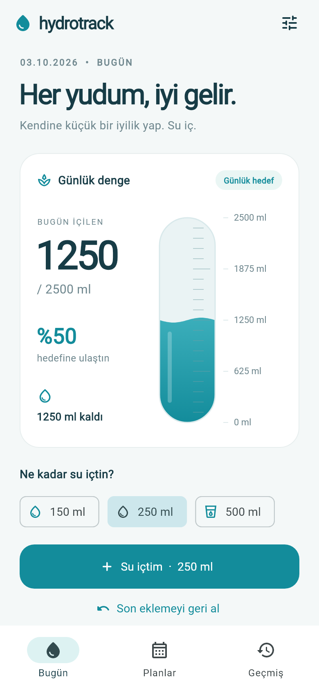

# HydroTrack

Flutter ile Android / iOS için yerel su takibi. İnternet hesabı veya sunucu gerekmez.

[Android test APK'sını indir](https://github.com/AhmetEmreTUMTURK/hydrotrack/releases/tag/v1.0.0-preview.1)

Bu APK debug imzalı bir önizleme sürümüdür. İlk kurulumda sıfır içim kaydıyla başlar.



## Paketler ve state management

- `flutter_riverpod`: `AsyncNotifier<HydrationState>` ile yükleme, işlem kilidi, hata ve güncel veri. Code generation gerekmez.
- `sqflite` + `path`: sürümlü SQLite veritabanı; planlar, aktif plan ve ayrı içim kayıtları.
- `flutter_local_notifications` **19.5.0**: doğrulanan API sürümüne sabitlenmiş yerel zamanlama; Android AlarmManager ve iOS UNUserNotificationCenter.
- `timezone` + `flutter_timezone`: cihazın IANA saat dilimi ve yaz/kış saati geçişlerine uygun takvim tarihleri.
- Flutter SDK `flutter_localizations`: Türkçe tarih/saat seçiciler.
- Test bağımlılığı `sqflite_common_ffi`: gerçek SQLite ile disk kalıcılığı ve transaction testleri.

`pubspec.lock` çözülmüş sürümleri sabitler. Bildirim paketi yükseltilecekse native kurulum yönergeleri de birlikte incelenmelidir.

Akış: **Widget → Riverpod controller → repository / reminder service**. UI doğrudan SQL veya native API çağırmaz. Controller veriyi önce kalıcı olarak yazar, yeni snapshot'ı okur, sonra bildirimleri uzlaştırır. Bildirim hatası başarılı içim kaydını geri almaz; ekranda yeniden deneme mesajı görünür. İşlem sürerken ikinci dokunuş reddedilir ve kontroller pasifleşir.

## Çalıştırma

```sh
flutter pub get
flutter analyze
flutter test
flutter run -d <android-veya-ios-cihaz-id>
flutter build apk --debug
```

Ürün hedefi Android/iOS'tur. Windows ve web için SQLite/bildirim adaptörü eklenmedi; bu platformlar şu an desteklenmez. iOS derlemesi için macOS + Xcode gerekir. Android release imzası başlangıç projesindeki debug imzasıdır; mağaza yayını öncesinde kendi signing yapılandırmanız gerekir.

## 1. UI katmanı

- `lib/presentation/home_screen.dart`: Bugün, Planlar ve bugünkü Geçmiş sekmeleri. 150/250/500 ml ekleme, geri alma, plan değiştirme, hata/boş/yükleme durumları.
- `lib/presentation/water_gauge.dart`: 68 px genişliğinde dikey bar, 20 ölçü bölmesi, hedefe göre ml etiketleri, dalgalı su yüzeyi. `TweenAnimationBuilder` 850 ms içinde mevcut seviyeden yenisine ilerler; geri alırken aşağı iner. Azaltılmış hareket tercihi desteklenir.
- `lib/presentation/plan_editor.dart`: plan adı, 250–10000 ml hedef, aynı gün içinde başlangıç/bitiş, 30 dk–12 saat aralık veya en fazla 24 özel saat. Alanlar doğrulanır; özel saatler aralık içinde olmalıdır. Geceye taşan aralık bu sürümde desteklenmez.
- `lib/presentation/theme.dart`: renkler, tipografi ve ortak kart. Kaydırılabilir ve maksimum 520 px genişlikte yerleşim.

### Tasarım doğrulama durumu

Verilen [Figma Make dosyası](https://www.figma.com/make/weONhngFBHlGbuqfpjKTQW/HydroTrack-Mobile-UI-Kit) için MCP kaynak bağlantıları döndü; ancak `resources/read` çağrısı `Unknown resource` verdi. Make dosyası için screenshot API desteklenmiyor. Tarayıcı görünümü oturum açma gerektirdi. Bu nedenle mevcut UI, kullanıcının metinsel tarifine göre hazırlanmış geçici uygulamadır; **pixel-perfect Figma eşleşmesi doğrulanmadı**. Renk/font/boşluk veya tasarım varlıklarının eşleştiği iddia edilmez. Sonraki eşleştirme için erişilebilir bir Design frame bağlantısı, tasarım ekran görüntüsü veya Make kaynak dışa aktarımı gerekir.

## 2. Veri ve geri alma

`lib/domain/models.dart` doğrulanmış ve değişmez modelleri tanımlar. `lib/data/hydration_repository.dart` şemayı ilk açılışta tek oluşturma işlemiyle kurar:

```sql
plans(id, name, goal_ml, start_minute, end_minute,
      interval_minutes, custom_minutes, reminders_enabled)
water_entries(id, plan_id, amount_ml, recorded_at, day)
settings(id = 1, active_plan_id)
```

Toplam, bugünün kayıtlarının `amountMl` değerlerinin toplamıdır; ayrı bir toplam sayacı tutulmaz. Geçmiş kaydı UTC epoch milisaniyesi ve kayıt anının yerel takvim günüyle saklanır. Seyahatte eski kayıtların gün etiketi yeniden yazılmaz. Yeni gün önceki verileri silmez.

Bir kişinin günlük tüketimi bütün planlar arasında paylaşılır. Plan değişince içilmiş su sıfırlanmaz; sadece hedef ve hatırlatma takvimi değişir. Her kayıt, eklendiği planı ayrıca taşır.

Geri alma algoritması gerçek kodda transaction içindedir:

```dart
final rows = await txn.query('water_entries',
  columns: ['id'], where: 'day = ?', whereArgs: [dayKey(now)],
  orderBy: 'id DESC', limit: 1);
if (rows.isEmpty) return false;
await txn.delete('water_entries',
  where: 'id = ?', whereArgs: [rows.single['id']]);
```

Aynı milisaniyede eklenen kayıtlar için artan birincil anahtar güvenilir sıralama sağlar. Gece yarısından sonra geri alma dünkü kaydı silmez. Hedef aşılabilir: gerçek tüketim korunur, yalnızca barın yüksekliği %100 ile sınırlandırılır.

Uygulama öne gelince veriler ve alarmlar yenilenir. Uygulama açıkken gün değişimi 30 saniyelik kontrolle fark edilir; kullanıcı işlemi her zaman güncel tarihi kullanır.

## 3. Alarm / arka plan katmanı

`lib/reminders/reminder_schedule.dart` saf zamanlama fonksiyonudur; test edilebilir. `lib/reminders/reminder_service.dart` native adaptördür.

1. Yalnızca aktif planın saatleri alınır; geçmiş saatler atlanır.
2. Bugünün hedefi doluysa bugüne bildirim yazılmaz. Yarın normal devam eder.
3. Ekleme, geri alma, plan kaydetme/değiştirme ve uygulamaya dönüşte 41000–41059 kimlikleri iptal edilip yeniden kurulur. Başka bildirim kategorileri etkilenmez.
4. Saat dilimi cihazdan tekrar okunur. Günler 24 saat eklenerek değil takvim tarihiyle oluşturulur. DST sırasında var olmayan saat atlanır.
5. İzin, kullanıcı planından hatırlatmayı açıp kaydedince istenir. İzin reddedilirse ekranda açıklanır.
6. Android kesin alarm izni varsa `exactAllowWhileIdle`, yoksa `inexactAllowWhileIdle` kullanılır ve gecikme uyarısı gösterilir.
7. Android yüksek önem derecesinde alarm ses URI'si ve titreşim deseni kullanılır. iOS sistem bildirim sesi ve time-sensitive bildirim kullanır.

Bu bildirimler Dart zamanlayıcısı değildir; işletim sistemi tarafından teslim edilir. Normal süreç sonlandırılmasında uygulama açık kalmak zorunda değildir. Bildirime dokunmak uygulamayı açar; **otomatik olarak içim kaydı oluşturmaz**.

### Android native kurulumu (eklendi)

`android/app/src/main/AndroidManifest.xml`:

- `POST_NOTIFICATIONS`, `VIBRATE`, `RECEIVE_BOOT_COMPLETED`, `SCHEDULE_EXACT_ALARM`.
- `ScheduledNotificationReceiver` ve `ScheduledNotificationBootReceiver`.
- Yeniden başlatma ve uygulama güncellemesinde bekleyen bildirimleri geri kurma intent'leri.

`android/app/build.gradle.kts`: Java 17, core library desugaring ve `desugar_jdk_libs:2.1.4`. Flutter 3.41.2'nin compile SDK değeri kullanılır; plugin en az API 35 ister. Beyaz bildirim ikonu `res/drawable/ic_water_notification.xml` içinde; küçültmede korunması için `res/raw/keep.xml` eklendi.

Bildirim kanalları ilk oluşturulduktan sonra ses/titreşim özelliklerini korur. Desen veya ses değişirse yeni kanal kimliği kullanın ya da test cihazındaki kanalı temizleyin. Kullanıcı kanalı sessize alabilir.

### iOS native kurulumu (eklendi)

`ios/Runner/AppDelegate.swift` UNUserNotificationCenter delegesini atar; plugin implicit Flutter engine üzerinden kayıt edilir. Normal yerel bildirim için background mode eklemek gerekmez. Bildirim izni uygulama içinden istenir. Varsayılan iOS bildirim sesi kullanılır; özel alarm sesi istenirse 30 saniyeden kısa uygun ses dosyasını Xcode Runner target'ının Copy Bundle Resources alanına ekleyip `DarwinNotificationDetails.sound` adını değiştirin.

iOS'ta arka planda serbest biçimli sürekli titreşim/ses çalıştırılamaz. Critical Alerts ayrı Apple yetkilendirmesi gerektirir; bu projede yoktur. Time-sensitive seçimi sessiz modu zorla aşma garantisi değildir. Windows üzerinde iOS native derlemesi doğrulanamaz.

### Zamanlama ufku ve uzun süre açılmama

Bu sürüm iOS'un 64 bekleyen bildirim sınırının altında kalmak için **en yakın 60 tek seferlik bildirimi**, en fazla 60 takvim gününe bakarak kurar. Varsayılan 2 saatlik plan yaklaşık bir haftalık kapsama verir; sıklık arttıkça süre azalır. Son kurulan tarih Planlar ekranında gösterilir. Uygulama açıldığında pencere yenilenir. Kullanıcı bu tarihe kadar uygulamayı hiç açmazsa sonraki alarmlar **kurulu değildir**. Kurulan bildirimler çalışmak için background Dart callback'e ihtiyaç duymaz.

Süresiz Android gereksinimi için sonraki entegrasyon:

1. Kotlin `BroadcastReceiver` + `AlarmManager` ile sadece bir sonraki plan saatini zamanlayın. Receiver SQLite'tan aktif planı ve o günün kayıt toplamını okusun; hedef doluysa bildirim göstermesin.
2. Receiver her tetiklenişte ertesi uygun saati yeniden kursun. `BOOT_COMPLETED`, `TIME_SET`, `TIMEZONE_CHANGED` ve exact-alarm permission değişiminde de aynı uzlaştırıcıyı çağırın. Flutter ile aynı DB yolunu, şema sürümünü ve işlem kilitlemesini paylaşın.
3. Alternatif olarak Workmanager ile günde bir kez mevcut 60 bildirimlik pencereyi genişletin. Callback'i `@pragma('vm:entry-point')` yapın, plugin kayıtlarını ve timezone verisini o isolate içinde başlatın. Ayrı DB bağlantısı ve foreground ile ortak transaction/lock kullanın; arka plan görevi izin istememeli.
4. Workmanager kesin saatte alarm değildir ve işletim sistemi görevi geciktirebilir. iOS BGTaskScheduler da sürekli arka plan çalışması veya zamanında yenileme garantisi vermez. iOS'ta pencere sonu/uygulamayı yeniden açma ihtiyacını ürün davranışı olarak koruyun.

Bu uzatma adımları **dokümantasyondur; background worker veya özel Kotlin receiver uygulanmış değildir**. Android Ayarlar → Zorla durdur, OEM pil kısıtları, bildirim/kanal izni, sessiz/DND modu ve cihaz kapalı olması teslimatı engelleyebilir. Uygulama bunları zorla aşmaz. Yerel DB commit'i ile OS zamanlaması tek atomik işlem değildir; arada süreç ölürse sonraki açılışta uzlaştırılır. Daha güçlü hedef-kontrol garantisi için yukarıdaki native receiver DB'yi bildirim anında okumalıdır.

## Test kapsamı

- Gerçek SQLite: ekleme, aynı zaman damgasında undo sırası, boş undo, kalıcılık, plan değiştirme, hedef aşımı ve gün sınırı.
- Riverpod: bildirim hatasında verinin korunması, eşzamanlı dokunuşların engellenmesi, hedef/undo sonrası yeniden zamanlama ve gece yarısı.
- Takvim: özel saatler, pencere sınırları, kapasite, hedef tamamlanması ve DST.
- Widget: telefon yerleşimi, sekmeler, plan editörü ve yukarı/aşağı dolum animasyonu.

Fiziksel cihaz kabul kontrolü ayrıca gereklidir: Android 13+ bildirim reddi, Android 14+ kesin alarm reddi, arka plan/normal süreç kapatma, yeniden başlatma, hedef tamamlandıktan sonra iptal, undo ile geri gelme, DND/sessiz, timezone değişimi ve iOS ses davranışı. Birim testleri gerçek cihazda ses/titreşim teslim edildiğini kanıtlamaz.

## Resmî kaynaklar

- [Flutter Local Notifications 19.5.0 kurulumu ve sınırları](https://pub.dev/packages/flutter_local_notifications/versions/19.5.0)
- [Android alarm zamanlama](https://developer.android.com/develop/background-work/services/alarms)
- [Flutter Timezone](https://pub.dev/packages/flutter_timezone)
- [Riverpod](https://riverpod.dev/)

## Görsel önizleme

`docs/home-preview.png`, 390×844 telefon yerleşiminin Flutter widget renderer çıktısıdır; **1250 ml örnek test verisi** kullanır. Gerçek uygulama ilk açılışta sıfır kayıtla başlar. Önizleme tasarım eşleşmesi kanıtı değildir.

Önizlemeyi yeniden üretmek için Flutter SDK font dizinindeki `roboto-regular.ttf` yolunu verin:

```sh
flutter test test/ui_test.dart --dart-define=WRITE_PREVIEW=true --dart-define=PREVIEW_FONT=<flutter-sdk>/bin/cache/artifacts/material_fonts/roboto-regular.ttf
```

## Bu çalışma sırasında doğrulama

- `flutter analyze`: sorun bulunmadı.
- `flutter test`: 17 test geçti; gerçek SQLite ve Flutter widget testleri dahil.
- `flutter build apk --debug`: başarılı. APK: `build/app/outputs/flutter-apk/app-debug.apk`.
- 390×844 önizleme görsel olarak incelendi.
- Fiziksel cihazda bildirim sesi/titreşimi, release derlemesi ve iOS derlemesi henüz doğrulanmadı.
